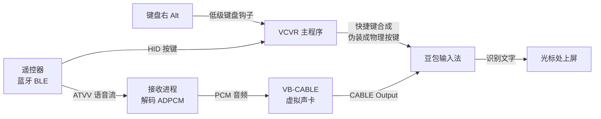

# VCVR — Vibe Coding Voice Remote (Windows)

> 把一只谷歌 Chromecast 语音遥控器，变成 Windows 上的**语音输入 + 快捷键外设**。
> 按住遥控器语音键说话，豆包把语音转成文字上屏；方向键、音量键、流媒体键全部可自定义。

[](LICENSE.md)
[](#快速开始)
[](#开发与构建)
[](#快速开始)

**VCVR = Vibe Coding Voice Remote**

---

## 它解决什么问题

写代码时手在键盘上，想说一句话却要切输入法、点麦克风按钮、等界面——打断思路。
一只 15 元的蓝牙遥控器放在手边，**按住说话、松开上屏**，全程不碰鼠标键盘。

同时它也是一只**可编程遥控器**：单击 / 双击 / 长按分别映射，方向键滚动、
流媒体键当复制粘贴用，长按连发可调。

| 谷歌遥控器按键映射 | 小米遥控器按键映射 |
| --- | --- |
|  |  |


---

## 功能特性

- **语音转文字**：遥控器麦克风 → 虚拟声卡 → 豆包输入法，按住说话、松开上屏
- **双触发入口**：键盘右 Alt 与遥控器语音键等价，可交叉开始/结束，互不干扰
- **开关型 / 按住型** 两种录音模式，开关型支持自动结束时长（最长 300 秒）
- **按键映射**：单击 / 双击 / 长按三档独立配置，动作包括按键组合、滚轮、
  输入文字、打开程序、触发 Quicker
- **长按连发**：滚轮 60ms 一格（约 16 格/秒），可选启用
- **两台遥控器**：小米遥控器 2 Pro、图示谷歌 Chromecast 遥控器
- **热拔插恢复**：遥控器休眠/唤醒自动重连，语音链路失败自动重试
- **诊断内建**：一键导出日志与诊断报告，问题定位不需要额外工具

---

## 快速开始

### 0. 下载与校验

当前正式版为 **1.0.104**（Windows 便携版，免安装）。

- 发布页：[`v1.0.104`](https://github.com/theziller1230-ai/vibe-coding-voice-remote/releases/tag/v1.0.104)
- 下载包：`RemoteMicRC003-1.0.104-portable-unsigned.zip`（内含主程序、权限助手与 `SHA256SUMS.txt`）
- 只取本版本的两个产物：`VCVR 1.0.104.exe`（主程序）与 `RemoteMicRC003HidHelper.exe`（权限助手）
- **从旧版升级**：旧版的主程序名是 `无线麦 win版 <版本号>.exe`。新版用
  `VCVR 1.0.104.exe`；程序会自动识别旧名并迁移开机自启项，无需手动改。
- 下载后请用同目录的 **`SHA256SUMS.txt`** 校验，哈希对不上就不要运行
- **完整解压**到一个固定目录（不要在压缩包里直接运行）
- 更新是**手动替换**：程序不会自动覆盖正在运行的副本。先**完全退出**旧版（托盘图标右键 →
  完全退出），再把新版解压到同一目录覆盖

> 更完整的操作步骤见 [使用说明](apps/windows/rc003/README.md)；
> 构建与内部结构见 [开发者文档](apps/windows/rc003/README.md)。

### 1. 准备

| 需要 | 说明 |
|---|---|
| Windows 10 / 11 x64 | |
| 蓝牙 | 遥控器通过蓝牙连接 |
| 豆包输入法 | [官网下载](https://www.doubao.com/)，建议 1.0.0.23 或更高 |
| VB-CABLE | [VB-Audio](https://vb-audio.com/Cable/) 免费虚拟声卡 |

### 2. 配对遥控器

支持 **图示谷歌 Chromecast 遥控器** 与 **小米遥控器 2 Pro**。

1. Windows **设置 → 蓝牙和其他设备 → 添加设备**
2. 遥控器长按配对键（或装电池自动进入配对）
3. 选择 `Chromecast Remote` / 小米遥控器2 Pro

### 3. 接线

- **VB-CABLE** 安装后重启
- 豆包输入法设置里，麦克风选择 **`CABLE Output (VB-Audio Virtual Cable)`**
- 程序的**语音输出端点**选 **`CABLE Input (VB-Audio Virtual Cable)`**
  —— 两端必须配对：程序往 `CABLE Input` 写，豆包从 `CABLE Output` 读
- 系统播放设备保持默认（声音从音箱/耳机正常出）

### 4. 运行

1. **以管理员身份**运行 `VCVR 1.0.104.exe`
   （必须提权，否则接收按键的辅助进程起不来）
2. 光标点进任意能输入文字的地方
3. **按住遥控器语音键**（下称**语音按键**）说话，松开 → 文字上屏
   也可以**按键盘右 Alt** 开始，再按一次结束

**真实输入自检**：把光标点进**记事本**，按住语音按键说一句话，松开后文字应上屏。
这一步通过，才说明整条链路是通的。

> 管理员权限只用于接收遥控器按键（Raw Input / HID），
> 不读取你的文件、不联网上传任何内容。

---

## 按键映射（出厂默认）

| 遥控器按键 | 动作 |
|---|---|
| 语音键（中间黑键） | 口述开 / 关（豆包转写） |
| 上 / 下 | **鼠标滚轮上 / 下**（长按连续滚） |
| 左 / 右 | 方向键 ← / → |
| 侧边音量 + / − | 方向键 ↑ / ↓ |
| 中心圆（确定） | 回车 |
| 返回 | 退格 |
| 主页 | 显示桌面 |
| 电源 | Esc |
| 静音 | 系统静音 |
| Netflix | Ctrl+V（粘贴） |
| YouTube | Ctrl+C（复制） |
| 输入源 | 禁用 |

改映射：程序左侧 **按键** 页，每列单击 / 双击 / 长按可分别设置，保存后立即生效。

> ⚠️ 某个键一旦配置了「长按」动作，长按就只触发一次，不会再连发。
> 想要连发就把该键的长按设为「未设置」。

---

## 工作原理



**为什么要「伪装成物理按键」**：豆包只认真实按键，纯 `SendInput` 注入会被丢弃。
VCVR 用 Frida 注入豆包进程，钩住 `ImeService.exe` 的键盘回调，
把注入的快捷键改写成物理键事件——这是整套方案里唯一"侵入"的部分，
也是它需要针对豆包版本适配的原因。

**音频链路**：遥控器麦克风 → BLE ATVV 流 → ADPCM 解码 → VB-CABLE → 豆包。
全程本地，音频不出机器。

---

## 豆包版本适配

钩子按**版本**硬编码三个 RVA + 文件哈希，豆包升级后需要适配。

| 豆包版本 | 状态 |
|---|---|
| v0.9.0.0 / v0.9.1.22 / v0.9.2.7 / v0.9.3.20 / v1.0.0.23 | 内置表支持 |

**豆包升级后（两步，不需要重新编译）**：

1. 双击 `适配新豆包版本.bat`
2. 重启 VCVR

脚本从当前豆包目录算出 **3 个文件哈希 + 3 个 RVA + 2 段签名字节**，
写进 `%LOCALAPPDATA%\RemoteMic\RC003\doubao_profiles.json`，
程序启动时自动合并进内置表（文件损坏会整段忽略，不会起不来）。

详细说明见 [`docs/豆包版本适配说明.md`](docs/豆包版本适配说明.md)。

---

## 故障排查

| 现象 | 处理 |
|---|---|
| 豆包不出字 | 豆包输入法麦克风要选 `CABLE Output (VB-Audio Virtual Cable)` |
| 按语音键没反应 | 程序必须**以管理员身份**运行；设备页显示「已连接」 |
| 界面提示未就绪 | **未就绪提示，按页面说明处理**（每条提示都对应一个可点击的修复动作） |
| 语音通道不可用 | 多按几次语音键唤醒遥控器；仍不行则重启 VCVR（日志 `voice control availability=`） |
| 停止后无法再次录音 | 见「豆包版本适配」，跑一次适配脚本 |
| 滚轮长按不连发 | 该键的「长按」动作被设置了，改回「未设置」 |
| 找不到遥控器 | 蓝牙设置里重新配对，按任意键唤醒 |

**诊断日志**：`%LOCALAPPDATA%\RemoteMic\RC003\logs\app.log`
关键行：`voice control availability=ready`、`Chromecast recording attempt=N`、
`voice PCM progress`（有值＝音频在流）。

---

## 开发与构建

> 更详细的设计说明、相对上游的改动清单与构建环境说明见 **[TECHNICAL.md](TECHNICAL.md)**。

```bat
cd apps\windows\rc003
python -m PyInstaller build\RemoteMicRC003.spec ^
    --distpath dist --workpath build\pyinstaller-work --noconfirm
```

产物：`dist\RemoteMicRC003\VCVR 1.0.104.exe` + `RemoteMicRC003HidHelper.exe`

**测试**：

```bat
cd apps\windows\rc003
set PYTHONPATH=src
python -m pytest tests -q
```

**目录结构**：

```
apps/windows/rc003/
├─ src/ovb_rc003/          核心模块
│   ├─ app.py                       主程序与状态机
│   ├─ chromecast_voice*.py         语音链路（接收端 / 宿主 / 闸门）
│   ├─ voice_key_physicalizer_windows.py   物理键伪装
│   ├─ key_mapping.py               按键映射与动作
│   └─ doubao_rpc.py                豆包私有 RPC
├─ tests/                  测试（4300+ 用例）
├─ build/                  PyInstaller 构建配置
└─ docs/                   设计与适配文档
```

---

## 已知限制

- **需要管理员权限**：接收遥控器 HID 按键依赖 Raw Input，提权不可避免
- **豆包版本绑定**：钩子按版本硬编码，豆包升级后需跑一次适配脚本
- **仅 Windows**：上游另有 macOS 实现，本分支不分发
- 音频走 VB-CABLE 虚拟声卡，首次配置需要一次性手动接线

---

## 致谢与许可

本项目是开源项目的衍生作品，感谢原作者：

- **[`nijez/open-voice-bridge`](https://github.com/nijez/open-voice-bridge)** —
  Windows RC003 客户端的原始实现（GPL-3.0-only）。来源与改动说明见
  [`apps/windows/rc003/ATTRIBUTION.md`](apps/windows/rc003/ATTRIBUTION.md)。
- **[`ZSTDJan/windows-remote-mic-app`](https://github.com/ZSTDJan/windows-remote-mic-app)** —
  「无线麦 Win 版」中文发行版，本项目的按键布局、豆包兼容表与中文文档来源于此。

第三方组件与软件边界见 [`THIRD_PARTY_NOTICES.md`](THIRD_PARTY_NOTICES.md)、
[`ASSET_LICENSES.md`](ASSET_LICENSES.md)。

### 许可

本项目按 **[GPL-3.0-only](LICENSE.md)** 发布。你可以自由使用、修改、分发，
但衍生作品必须同样以 GPL-3.0 发布并提供源码。

> **商标声明**：本分支不分发原 macOS 应用的 Swift 源码、AppKit 资源、
> 官方 Logo 或 macOS 驱动安装包；对这些已移除内容不授予任何品牌资产使用权。
> 「VCVR」是本分支的名称，与「无线麦」及其原厂商无关联。
